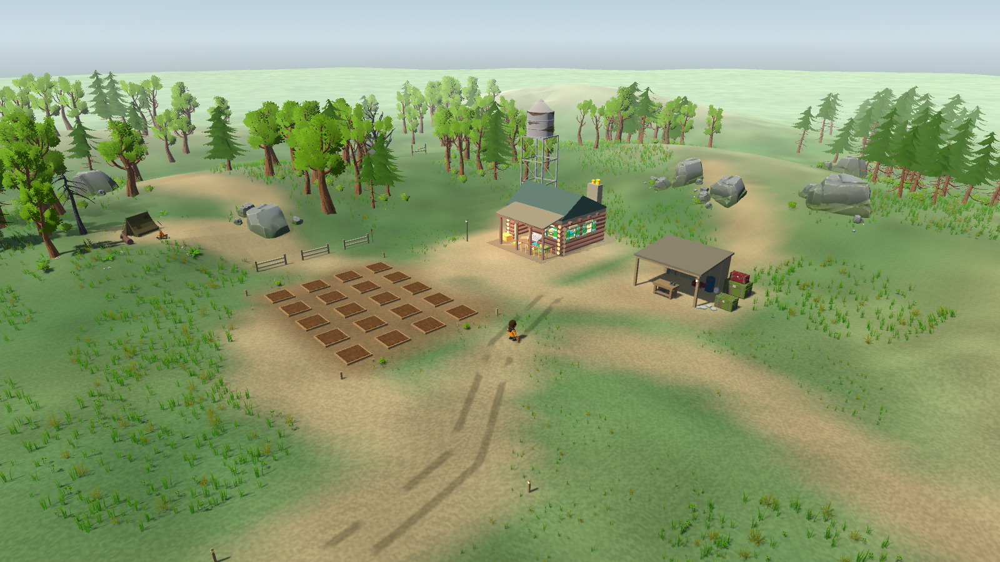

# Somchai’s Last Harvest

**ปลูกในตอนกลางวัน เอาชีวิตรอดในตอนกลางคืน**

เกมผู้เล่นคนเดียวแนว **3D Farming Survival Shooter** มุมมองบุคคลที่สาม ในฟาร์มชนบทแบบ Low Poly คุณรับบทเป็นสมชาย ปลูกพืชทรัพยากร เก็บผลผลิต คราฟต์อาวุธและกระสุน แล้วป้องกันตัวจากซอมบี้ที่บุกทุกคืน

เป้าหมายคือ **รอดครบ 10 คืน** เพื่อรับการช่วยเหลือจากเฮลิคอปเตอร์ในเช้าวันที่ 11

## เริ่มเล่น

- [เล่นผ่าน GitHub Pages](https://siraanpimpa.github.io/project3d_2026/) บนคอมพิวเตอร์ที่มีคีย์บอร์ด เมาส์ และเบราว์เซอร์รองรับ WebGL 2
- **Continue · Day N** เป็นปุ่มหลักเมื่อมีเซฟล่าสุดที่โหลดได้ ส่วน **New game** เริ่มวันที่ 1 เวลา 06:00 พร้อมของเริ่มต้น หากไม่มีเซฟหรือจบรอบแล้ว จะซ่อน Continue
- หลังโหลดฉากบนเว็บ ให้คลิกพื้นที่เกมเพื่อจับเมาส์และควบคุมมุมมอง หลังปิดเมนูด้วยคีย์บอร์ดหรือสลับกลับมาจากหน้าต่างอื่น อาจต้องคลิกเพื่อเล่นต่อ
- เปิด **How to play** ในเมนูเพื่อดูปุ่มควบคุม

## วิธีเล่น

### กลางวัน: ปลูกและเตรียมตัว

ฟาร์มมี **20 แปลง แบบ 4×5** กด **Q** เข้า Farming เลือกเมล็ดด้วยล้อเมาส์หรือกระเป๋า **Tab** แล้วเข้าใกล้แปลงว่างและกด **E** เพื่อปลูก เมื่อโตเต็มที่ กด E ที่แปลงเพื่อเก็บผลผลิต หากกระเป๋าเต็ม ต้นจะยังรอให้กลับมาเก็บ

| พืช | ผลผลิตต่อแปลง |
|---|---|
| Lead Plant | Lead ×2 |
| Paper Plant | Paper ×3 |
| Iron Plant | Iron ×2 |
| Copper Plant | Copper ×2 |
| Small Herb | Small Herb ×1 |
| Large Herb | Large Herb ×1 |
| Fire Pepper | Fire Essence ×2 |
| Ice Plant | Ice Crystal ×2 |
| Poison Plant | Poison Extract ×2 |

ไปที่ **Workbench** และกด E เพื่อคราฟต์ หน้าคราฟต์แบ่งเป็น **Ammo / Weapons / Parts** โดย Parts รวมชิ้นส่วน ยา และเกราะ อาวุธทุกชนิดคราฟต์ได้ตั้งแต่วันแรกเมื่อมีวัตถุดิบครบ สูตรอาวุธที่มีอยู่หรือเคยคราฟต์แล้วจะถูกซ่อนเพื่อป้องกันการคราฟต์ซ้ำ

### กลางคืน: ต่อสู้และรักษาระยะ

กลางคืนเริ่ม **18:00** และสิ้นสุด **06:00** กด Q เข้า Combat คลิกขวาค้างเพื่อเล็งปืน แล้วคลิกซ้ายยิง อาวุธประชิดใช้คลิกซ้ายได้โดยไม่ต้องเล็ง ใช้ล้อเมาส์สลับอาวุธที่สวมไว้

ปืน **รีโหลดอัตโนมัติเมื่อแม็กเหลือ 0 นัดและมีสำรอง** ใช้เวลารีโหลดตามอาวุธ และตัดกระสุนจากกระเป๋าเมื่อเสร็จ กด **R** เพื่อรีโหลดก่อนหมดได้ เปิดเมนู เปลี่ยนอาวุธ หรือเข้า Farming จะยกเลิกการรีโหลด เมื่อกลับมาควบคุมปืนแม็กว่างได้จะเริ่มใหม่

**ยิงหัวทำ damage ×1.5** รวมโบนัส Fire ก่อนคูณ และแสดงเครื่องหมายโดนสีแดง ส่วน damage ต่อเนื่องจากธาตุไม่คูณหัว

เมื่อกำจัดศัตรูของคืนนั้นหมด กลับไปที่เตียงในกระท่อมและกด **E** เพื่อพักจนเช้า พร้อมฟื้น HP/Stamina หากรอจนเช้าตามปกติจะขึ้นวันใหม่โดยไม่ฟื้น HP ให้

กลางวันกด **X** เพื่อเปิดหน้าต่างยืนยันข้ามไปเวลา 18:00 ของวันเดียวกัน พืชเติบโตตามเวลาที่ผ่านไป โดยไม่ฟื้น HP/Stamina และไม่เพิ่มวัน

## อาวุธและอุปกรณ์

เริ่มเกมด้วย **Pistol และ Wooden Bat** ปืนเริ่มด้วยแม็กว่าง ต้องปลูกวัตถุดิบเพื่อคราฟต์กระสุนก่อน

| อาวุธ | Damage | แม็ก / ระยะประชิด |
|---|---:|---|
| Wooden Bat | 10 | 1.6 ม. |
| Knife | 15 | 1.9 ม. |
| Sword | 50 | 3 ม. |
| Pistol | 20 | 12 นัด |
| SMG | 25 | 30 นัด |
| Assault Rifle | 40 | 25 นัด |
| Marksman Rifle | 100 | 5 นัด |

SMG และ Assault Rifle ยิงต่อเนื่องเมื่อคลิกซ้ายค้างขณะเล็ง Pistol และ Marksman Rifle ยิงหนึ่งนัดต่อการคลิก อาวุธประชิดฟันหนึ่งครั้งต่อการคลิกและไม่ใช้กระสุน

เปิด Tab เพื่อดู **Seeds & Supplies / Weapons / Armor** แยกเป็นคนละกรอบ ชี้เมาส์ที่ไอเท็มเพื่อดูรายละเอียด เลือกอาวุธแล้วคลิกช่อง **Slot 1–3** เพื่อสวมใส่ ปุ่ม × ถอดออกจากช่องโดยยังเก็บไว้ในกระเป๋า

**Heavy Armor** ปลดล็อกวันที่ **6** ใช้ **Iron ×4 + Copper ×2** ลด damage ที่ได้รับ **40%** สวมอัตโนมัติเมื่อได้รับครั้งแรก และสวม/ถอดได้ในกรอบ Armor ไอคอนโล่ข้าง HP แสดงเมื่อสวมอยู่

## กระสุนและระเบิด

ปืนทุกชนิดใช้กระสุนทั้งสี่แบบได้ **ทุกสูตรได้ 10 นัดต่อครั้ง** กด **C** วนเลือกชนิดที่มีอยู่ การเปลี่ยนชนิดใช้การรีโหลดตามปกติและคืนกระสุนเก่าเข้ากระเป๋า

| กระสุน | วัตถุดิบต่อครั้ง | ผลพิเศษ |
|---|---|---|
| Basic | Lead ×1 + Paper ×1 + Copper ×1 | Damage ตามอาวุธ |
| Fire | Fire Essence ×1 + Paper ×1 + Copper ×1 | เพิ่ม damage นัดละ 10; Marksman Rifle เพิ่ม 50 และเผา 1% Max HP ต่อวินาที นาน 5 วิ |
| Ice | Ice Crystal ×1 + Paper ×1 + Copper ×1 | ลดความเร็ว 50% นาน 4 วิ รวมถึงการพุ่งของบอส |
| Poison | Poison Extract ×1 + Paper ×1 + Copper ×1 | พิษ 5% Max HP ต่อวินาที นาน 3 วิ และลด damage ของศัตรู 10% นาน 3 วิ |

ธาตุคนละชนิดติดพร้อมกันได้ ยิงธาตุเดิมซ้ำต่ออายุโดยไม่ทบความแรง หากชนิดที่เลือกหมด Auto Reload จะกลับไปใช้ Basic เมื่อมีสำรอง

**Ice Grenade** ปลดล็อกวันที่ **5** ใช้ **Ice Crystal ×2 + Iron ×1 + Paper ×1** คราฟต์ได้ 1 ลูก กด **G** ใน Combat เพื่อขว้าง วงระเบิดรัศมี **6 ม.** ลดความเร็วศัตรู **50% นาน 4 วิ** ไม่ทำ damage และสิ่งกีดขวางทึบกันเอฟเฟกต์ได้

## ยารักษา

กด **V** สลับระหว่างยา Basic / Full ที่มีในกระเป๋า แล้วกด **F** ใช้ยาที่เลือก HUD แสดงไอคอน ชนิด และจำนวนยา ใช้ได้ทั้ง Farming และ Combat เมื่อปิดเมนู

| ยา | วัตถุดิบ | ผล |
|---|---|---|
| Basic Medicine | Small Herb ×2 | ฟื้น 30 HP |
| Large Medicine / Full | Large Herb ×2 | ฟื้น HP เต็ม |

ไม่เสียยาเมื่อ HP เต็ม ยาทั้งสองแบบใช้ cooldown ร่วมกัน **0.5 วิ** Large Herb Seed เริ่มแจก **วันที่ 7** เพื่อนำไปปลูกและคราฟต์ยา ไม่มีการแจกยา Full โดยตรง

## ซอมบี้และบอส

| ศัตรู | HP | Damage | ลักษณะ |
|---|---:|---:|---|
| Normal | 150 | 15 | ความเร็วปกติ |
| Runner | 100 | 10 | ตัวเล็ก วิ่งเร็ว |
| Tank | 500 | 30 | Big Arm สีแดง ตัวใหญ่ เดินช้า |
| Big Arm Boss | 2,000 | ตี 40 / พุ่ง 60 / กระโดดทับ 60 | ตัวใหญ่ ตาแดง มีแถบ HP |

บอสมีท่าพุ่งเตรียม **2.5 วิ** และท่ากระโดดทับเตรียม **3 วิ** แต่ละท่ามี cooldown **15 วิ** เตือนด้วยแถบแดงหรือวงแดงบนพื้นโดยไม่มีตัวเลขวินาที ให้เคลื่อนออกจากพื้นที่ก่อนโจมตี

**คืนที่ 7** บอสออกเป็นตัวแรก 1 ตัว ส่วน **คืนที่ 10** ออกตัวแรกก่อน เมื่อกำจัดได้ อีก **2 ตัวออกพร้อมกัน** จำนวนศัตรูบน HUD รวมบอสที่รอเกิดด้วย

## เสบียงและความคืบหน้า

เสบียงเป็นเมล็ดสำหรับปลูก ได้เมล็ดพื้นฐานแต่ละชนิดทุกเช้า และ Large Herb เมื่อปลดล็อก ส่วนเมล็ดธาตุเลือกได้หนึ่งชนิดที่ปลดล็อกแล้ว

| วัน / คืน | เมล็ดต่อชนิด | ศัตรูทั้งหมด | สิ่งที่ปลดล็อก |
|---|---:|---:|---|
| 1 | 4 เริ่มต้น | 6 | เมล็ดพื้นฐาน / สูตรอาวุธทั้งหมด |
| 2 | 4 | 7 | — |
| 3 | 5 | 9 | Fire Seed / Fire Ammo |
| 4 | 5 | 11 | — |
| 5 | 6 | 13 | Ice Seed / Ice Ammo / Ice Grenade |
| 6 | 6 | 15 | Heavy Armor |
| 7 | 7 | 16 | Poison Seed / Poison Ammo / Large Herb / Large Medicine |
| 8 | 12 | 18 | — |
| 9 | 14 | 20 | — |
| 10 | 16 | 27 | คืนสุดท้าย รวมบอส 3 ตัว |

Large Herb Seed ได้โบนัสปลดล็อกครั้งแรกอีก **3 เมล็ดในวันที่ 7** เมื่อปลดล็อกธาตุเพียงไฟ จะได้รับเมล็ดไฟอัตโนมัติทุกเช้า เมื่อมีสองชนิดขึ้นไป หน้า **Choose your seeds** ให้เลือกหนึ่งชนิด ชนิดที่ยังไม่ปลดล็อกแสดง Lock หากกระเป๋าเต็ม รางวัลจะรอจนมีพื้นที่

## ปุ่มควบคุม

| ปุ่ม | การใช้งาน |
|---|---|
| WASD / Shift | เดิน / วิ่ง |
| E | ปลูก เก็บเกี่ยว เปิด Workbench หรือใช้เตียง |
| Q | สลับ Farming / Combat |
| Tab | เปิดกระเป๋าและจัดอุปกรณ์ |
| ล้อเมาส์ | เลือกเมล็ด / สลับอาวุธตามโหมด |
| คลิกขวาค้าง / คลิกซ้าย | เล็ง / ยิงหรือโจมตีประชิด |
| R / C | รีโหลดเอง / เปลี่ยนชนิดกระสุน |
| V / F | สลับยา Basic–Full / ใช้ยาที่เลือก |
| G | ขว้าง Ice Grenade ใน Combat |
| Z | สลับไหล่กล้อง |
| X | เปิดหน้าต่างข้ามไปกลางคืน |
| Esc | ปิดหน้าต่าง / Pause / ย้อนกลับ |
| T | เปิด–ปิด Cheat commands |

[คู่มือควบคุมเพิ่มเติม](CONTROLS.md)

## บันทึกและเล่นต่อ

เกมบันทึกอัตโนมัติเมื่อต้นวัน เลือก **Continue** เพื่อกลับเวลา **06:00 ของวันล่าสุด** พร้อมทรัพยากร อาวุธ กระสุน พืช เกราะ HP/Stamina และสิ่งที่ปลดล็อก ณ ต้นวันนั้น สิ่งที่ทำหลังเริ่มวันต้องเล่นใหม่ **Restart day** ใน Pause ใช้เซฟเดียวกัน

New game มีหน้าต่างยืนยันก่อนแทนที่เซฟเดิม บนเว็บเซฟอยู่ในเบราว์เซอร์ของเครื่องที่เล่น ไม่รวมอยู่ในไฟล์เกมบน GitHub การล้างข้อมูลเว็บไซต์หรือใช้โหมดส่วนตัวอาจทำให้เซฟหาย

## การตั้งค่าและคำสั่งทดลอง

**Settings** ปรับความไวเมาส์ เสียง และภาพได้ เลือก **Low / Medium / High**, เปิด–ปิด Shadows หรือปรับความละเอียดภาพ 3D ระหว่าง **50–100%** เครื่องที่กระตุกควรเริ่ม Low และปิดเงา ค่าเริ่มต้นคือ Medium และบันทึกข้ามการเปิดเกม

เสียงในเกมมีบรรยากาศ ยิงปืน เก็บเกี่ยว คราฟต์ เดิน และซอมบี้ตามตำแหน่ง หากเว็บพักเสียงไว้ ให้คลิกพื้นที่เกมหรือ **Enable sound**

กด **T** ระหว่างเล่นเพื่อเปิด Cheat commands: ข้ามวัน ปลดล็อก เสกของ/ซอมบี้ ฟื้น HP/Stamina หรือลัดไปตอนจบ ไม่มีปุ่มเข้าหน้านี้จาก Settings และเกมหยุดขณะเปิด

## เปิดและพัฒนาโปรเจกต์

ใช้ **Godot 4.7** เปิด `project.godot` แล้วกด **F5** โปรเจกต์ใช้ Compatibility renderer

| ไฟล์ / โฟลเดอร์ | หน้าที่ |
|---|---|
| `project.godot` / `export_presets.cfg` | ตั้งค่าโปรเจกต์และการส่งออก |
| `scenes/` / `scripts/` / `resources/` | ฉาก ระบบเกม และข้อมูล |
| `Asset/` / `assets/` | โมเดลต้นฉบับ ภาพ เสียง และ shader |
| `docs/` | Web build ล่าสุด คู่มือ Web และไลเซนส์ Godot |
| `tests/` / `tools/` | สคริปต์ตรวจระบบ เครื่องมือสร้าง asset/bake และ Web shell |

`.godot/` เป็น cache ที่ Godot สร้างใหม่ได้ ไม่ต้องส่งขึ้น GitHub การเปิดหลังล้าง cache จะนำเข้า asset ใหม่ ผลทดสอบ ภาพจับจอ และรายงานชั่วคราวควรเก็บนอกโฟลเดอร์เกม

Export Web ไปที่ `docs/index.html` โดยติดตั้ง export templates รุ่นตรงกับ Godot ก่อน รักษาไฟล์ `index*` ทั้งชุดไว้ด้วยกัน หากเพิ่มทรัพยากรที่โหลดผ่าน path ในสคริปต์ ให้เพิ่มใน export preset ด้วย

คู่มือเพิ่มเติม: [Web และ GitHub Pages](docs/WEB_README.md) · [โครงสร้างโปรเจกต์](PROJECT_ARCHITECTURE.md) · [เครดิตทรัพยากร](ASSET_CREDITS.md)
